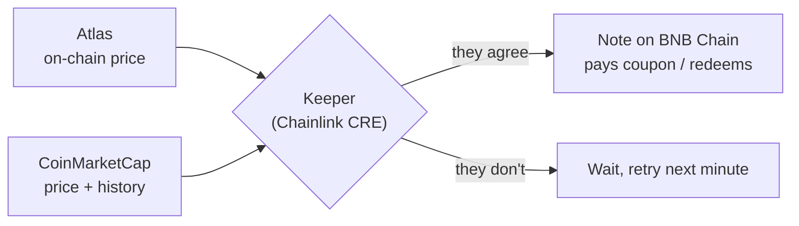

# notes.markets on BNB Chain

**Structured notes on Binance's stock tokens, priced by Atlas and checked by CoinMarketCap.**

BNB Hack Bangkok 2026 · CoinMarketCap × Atlas challenge · **Live:** https://bnb.notes.markets ·
**[Watch the 1-minute demo](docs/video/notes-markets-bnb-demo.mp4)**

## The idea in one minute

A **structured note** is a product banks sell: *"Earn 2.5% each quarter while Tesla and Nvidia stay above 70% of
today's price. If either ends below that line, you take the loss."*

We let anyone issue one on BNB Chain, written on Binance's stock tokens (Tesla, Nvidia, the S&P 500 and 11 more),
with the issuer's collateral locked in the note and every payment made automatically.

A note pays or fails on a few prices. **One wrong price moves real money, and nobody can undo it.** So:

1. **Atlas sets the price:** its on-chain price of the token on BNB Chain, live around the clock, including weekends.
2. **CoinMarketCap must agree:** within 3% while the US market is open, 2% while it is closed. If not, the note waits.
3. **If Atlas flags its own sources as unreliable, the note waits too.**



CoinMarketCap's data also powers three things investors and issuers see:

- **Back-test:** how these exact terms would have done, started on every past day since the tokens listed.
- **Spike protection:** each price can be a 15-minute median, and a check during a violent move is postponed.
- **Collateral sizing:** an issuer who locks stock tokens is told how much they count for, given the token's DEX
  liquidity on BNB Chain.

## See it working

| | |
|---|---|
| A finished note (Tesla & Nvidia tokens, redeemed at 1.075) | [note 3](https://bnb.notes.markets/app/note/bnb-testnet:0x37184a9d436b9e8f2225cafd5474e60a5d18fdeb:3) |
| A live note, checks on 26–27 Nov | [note 4](https://bnb.notes.markets/app/note/bnb-testnet:0x37184a9d436b9e8f2225cafd5474e60a5d18fdeb:4) |
| Atlas's signed live prices, signature verified | [/api/market/atlas](https://bnb.notes.markets/api/market/atlas?symbols=TSLAB,NVDAB) |
| Issue your own (no wallet needed until the last step) | [bnb.notes.markets/app](https://bnb.notes.markets/app) |

## Data used

| Provider | Endpoint / feed | Why |
|---|---|---|
| Atlas | Multi-Feed `fetch(bytes4)` on BNB Chain mainnet | The price every note is fixed on |
| Atlas | Signed price API `/report/v1/price/latest` | Live price on the note page; quality rating as a stop |
| CoinMarketCap | `/v3/cryptocurrency/quotes/historical` (5 min, daily) | Second source, medians, back-test |
| CoinMarketCap | `/v1/dex/token` (BNB Chain) | Liquidity for collateral sizing |

## BNB Chain addresses

| What | Address |
|---|---|
| Atlas Multi-Feed (mainnet) | `0xeace519ebb14fb8404fa6ddd23c3b34abade44aa` |
| Note engine (testnet, chain 97) | `0x37184A9D436B9e8F2225cAFd5474E60A5d18FDEb` |
| Lens (read model) | `0xF486dfaa1111Dd20B931b304Ec7d0B967463a086` |
| Test dollar nmUSD | `0x199816ce7e0b2366b408D6F8c3158844f06E3099` |
| Faucet | `0xC7cdfBfE828E99b9bdF14CF1aBaA49b44922c8A6` |

Notes run on testnet with stand-in tokens; the prices are the real mainnet ones. Contracts are not audited.

## Run it

```bash
npm install
npm run typecheck && npm test        # no keys needed
```

Full setup (keys, demo note, keeper, site): [docs/ATLAS-CMC.md](docs/ATLAS-CMC.md#run-it). API keys stay in
server secrets; none are in this repository or the app.

## More

- [docs/SUBMISSION.md](docs/SUBMISSION.md): one-page write-up
- [docs/ATLAS-CMC.md](docs/ATLAS-CMC.md): exactly how each data source is used, failure cases, code map
- [docs/EXPLAINER.md](docs/EXPLAINER.md): the one-minute spoken explainer
- [docs/DEMO-BNB.md](docs/DEMO-BNB.md): three-minute demo script
- **What's new this week:** everything after git tag `pre-hackathon` (`git log pre-hackathon..main`). The note
  engine, keepers and app existed before; all Atlas and CoinMarketCap work was built here.
- The wider product (Robinhood Chain, Base, cross-chain collateral): [docs/PRODUCT.md](docs/PRODUCT.md)
